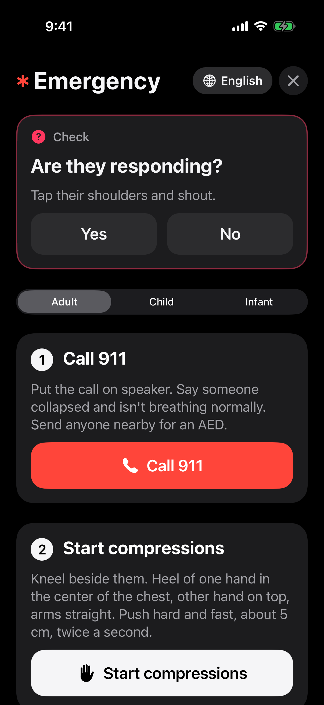
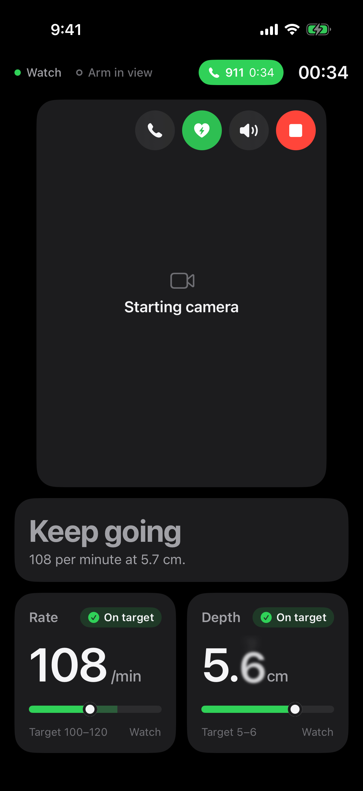
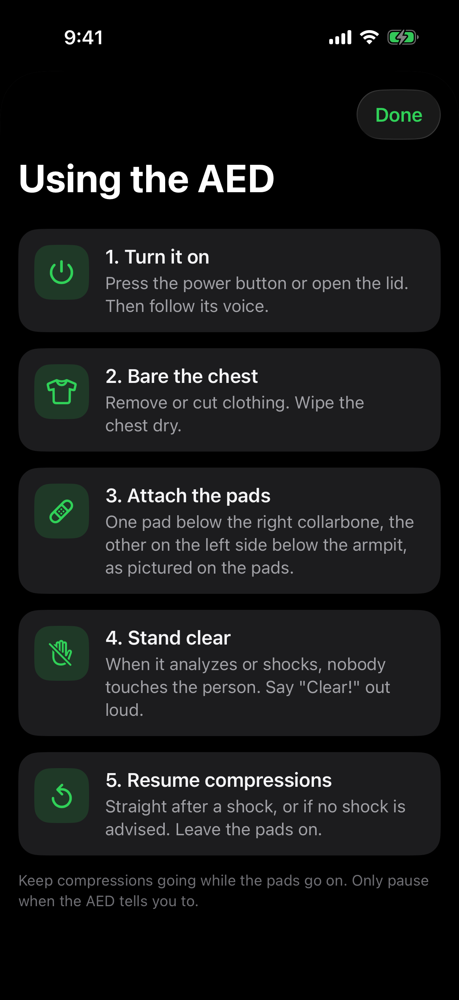
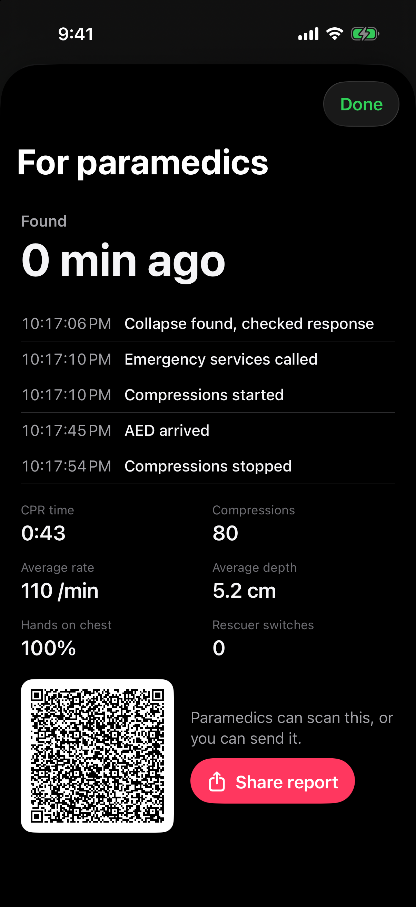
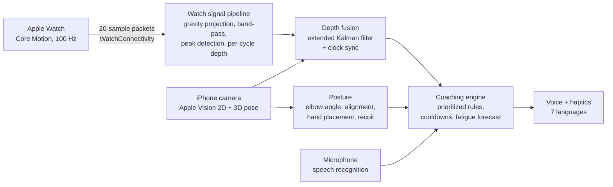

# CPR Coach

**Real-time CPR coaching from the iPhone and Apple Watch you already own.**

HackOHI/O 2026 · Aaron Zheng, Jaeha Lee, Eason Zheng

> Training and coaching tool, not a medical device. The app never dials 911: the emergency call in the demo is simulated.

## Demo video

[](https://youtu.be/oubjYkOBK_0)

## The problem

About 263,000 Americans have a cardiac arrest outside a hospital each year that EMS treats. Only about four in ten get CPR from a bystander, and survival drops by up to ten percent for every minute without CPR. About seven in ten of these arrests happen at home, where the person helping usually has no recent training and no idea whether they're pushing hard enough or fast enough.

We looked at what already exists:

| | Helps during a real emergency | Checks your form | Measures depth | Nothing extra to buy* |
|---|:-:|:-:|:-:|:-:|
| CPR classes | – | In class only | In class only | – |
| Feedback devices (under your hands) | ✓ | – | ✓ | – |
| Phone-on-chest apps | ✓ | – | ✓ | ✓ |
| 911 dispatcher | ✓ | – | – | ✓ |
| **CPR Coach** | **✓** | **✓** | **✓** | **✓** |

\* For CPR Coach, assuming you already own an iPhone and an Apple Watch.

Classes only help during training. Feedback devices sit under your hands and are bought for trained responders; a single sensor can misread depth on a soft surface like a mattress. In a 240-person manikin study, a phone-on-chest app didn't improve effective compressions compared with no feedback at all. And a 911 dispatcher can't see you.

Sources: [AHA CPR facts and stats](https://cpr.heart.org/en/resources/cpr-facts-and-stats) and the CARES registry (incidence, bystander CPR, home); "Comparing three CPR feedback devices and standard BLS in a single rescuer scenario: a randomised simulation study", [*Resuscitation*, 2014](https://www.resuscitationjournal.com/article/S0300-9572(13)00835-6/abstract) (the 240-person study).

## The idea

Two devices millions of people already carry can see and feel CPR between them:

- **The Apple Watch is on the wrist that's doing the pushing.** Its motion sensor feels every compression, 100 times a second.
- **The iPhone, propped on the floor beside you, can watch your body.** It can see if your elbows are bent, if your shoulders are over your hands and where your hands are on the chest.

Neither one is good enough alone, so CPR Coach combines them on the phone and talks to you like an instructor kneeling next to you.

## What it does

<p>
  
  
  
  
</p>

A rescue, start to finish:

1. **Tap "Someone collapsed?"** (or say "Hey Siri, start CPR", or use the Action button).
2. **It checks the person with you.** "Tap their shoulders and shout. Are they responding?" You answer "yes" or "no" out loud. Then: "Are they breathing normally? Gasping doesn't count."
3. **It gets help coming.** If they're not breathing, it starts a simulated emergency call and a metronome at 110 beats a minute.
4. **It coaches every compression**, out loud and on the watch with wrist taps:
   - rate: "Faster", "Slow down"
   - depth: "Push harder", "A little less force"
   - form: "Lock your elbows", "Shoulders over your hands", "Let the chest come all the way up"
   - hand position on the chest
5. **You stay hands-free.** Ask "How am I doing?", "How long?", "Swap" or "Call for help". It answers without you touching the phone.
6. **It predicts fatigue.** It spots your compressions getting shallower and tells you to switch rescuers before quality drops. Every two minutes it reminds you to switch.
7. **The AED guide** shows where the pads go when a defibrillator arrives.
8. **Say "Stop"** and it creates a **report for paramedics**: when the collapse was found, when help was called, how long CPR ran, compression quality and when the AED arrived, with a QR code.

Also:
- **Seven languages:** English, Spanish, French, Chinese, Korean, Japanese and Hindi, for both voice and commands.
- **Adult, child and infant modes** with the right depth targets for each.
- **A 30:2 mode** with rescue breaths.
- **Practice mode** with an AI debrief, and a two-minute **skills check** for classes.
- **A Live Activity** keeps the instruction, rate and depth on the lock screen.

## How we built it



### 1. Feeling each push with the watch

The watch app runs a workout session (HealthKit) so it stays awake. It streams Core Motion data at 100 Hz to the phone in 200 ms packets of 20 samples.

On the phone, each sample's acceleration is **projected onto gravity**, so we get "up and down" no matter how the watch sits on the wrist. A band-pass filter keeps the CPR frequencies. An online peak detector finds the bottom and top of every compression, which gives the rate.

For depth, we **integrate the acceleration twice over each single compression cycle**, from one top to the next, and remove the linear drift. Because each cycle starts fresh, integration errors can't pile up across compressions.

### 2. Seeing your form with the camera

The phone runs Apple Vision body pose on the front camera at its widest field of view. Center Stage is off and zoom is at minimum, so a phone on the floor sees your whole upper body.

- **Elbows:** a flat image distorts angles when your arm isn't side-on to the camera, so a straight arm can look bent. We run Apple's **3D body pose** alongside the 2D one to get the true elbow angle. When 3D isn't available, we allow an extra 8° of slack, because perspective can only make a straight arm look bent, never straighter.
- **Shoulders over hands:** we check the angle of the shoulder-to-wrist line from vertical.
- **Hand placement:** Vision also finds the patient lying down. We measure where your hands are along their torso, from shoulders (0) to hips (1). The lower half of the breastbone is about 0.2–0.45.
- **Chest recoil:** the highest wrist positions over recent compressions mark the chest at rest. A stroke that stops clearly short of that means you're leaning.

### 3. Combining them: one true depth

This is the core of the project. The watch is precise but drifts. The camera never drifts but only knows pixels, not centimetres.

We built an **extended Kalman filter** (`apple/Sources/iOS/Coach/DepthFusion.swift`) with four states:

- `p`: wrist height in metres
- `v`: wrist velocity
- `s`: the camera's scale, in pixels per metre
- `b`: the camera's offset, in pixels

The watch's acceleration drives `p` and `v`. Each camera frame is a measurement of `b − s·p`, which corrects them.

The result is drift-free depth in centimetres. **The camera also calibrates itself from the watch**, so if the watch drops out, camera-only depth stays in real units.

Before fusing, we line up the two clocks (see Challenges). Depth the app coaches on always comes from measured data. The rough camera-only estimate is shown as "≈" and never triggers "Push harder".

### 4. Deciding what to say

The coaching engine is a list of rules in priority order:
1. give 2 breaths (in 30:2 mode)
2. no compressions
3. switch rescuers now
4. too shallow, or getting tired (switch soon)
5. too slow
6. too fast, or hands in the wrong place
7. chest not coming all the way up
8. elbows bent
9. shoulders not over hands
10. too deep
11. praise

Every quarter second, the most important active rule sets the on-screen banner. Only one line is spoken at a time, at least 6 seconds apart, and the same correction repeats at most every 15 seconds, so it coaches without nagging.

**Fatigue forecast:** we fit a least-squares line to the last minute of per-compression depths. If the slope is falling at least 2.5 standard errors below zero, and the trend will cross the target within 40 seconds, and that has held for 5 seconds, it says "You're tiring. Get ready to switch rescuers."

### 5. Talking to it

Both hands are on the chest, so everything works by voice.
- **Speech recognition:** Apple's speech recognizer runs on the phone, on-device where the language supports it.
- **Commands:** keyword matching per language, where negatives win. "Not breathing" counts as a no, and "don't stop" never stops.
- **Ignoring itself:** the coach is talking from the same phone, so we strip its own words out of what the microphone hears and restart listening when it finishes a line. You can talk over it and it still hears you.
- **Answering:** replies to your questions cut in straight away.

### 6. The AI debrief

After a practice session, rules over the measured stats pick what went well, the one thing to fix and why it matters. Advice is always grounded in real measurements. On devices with Apple Intelligence, **Apple's on-device language model** (Foundation Models) turns those facts into a short spoken-style debrief in your language. Nothing leaves the phone.

### 7. Also on the web

A React + TypeScript version runs the same coaching rules in the browser, with MediaPipe Pose and the Web Speech API. A Python (FastAPI, NumPy, SciPy) backend runs the original watch signal pipeline. The phone's Swift pipeline is a port of it.

## Challenges we overcame

Our first version had three big problems, and we tested every fix:

| Problem | Before | After | How we fixed it |
|---|---|---|---|
| Camera-only depth | 2–9 cm spread | 0.2 cm error | The camera can't measure distance, so we fused it with the watch's motion sensor in a Kalman filter |
| 40 ms clock gap between phone and watch | 10% depth error | ±1% | Bluetooth delay and camera processing put the two streams out of step. On a side view, the camera's wrist height moves in step with the watch's acceleration, so we **cross-correlate** the two signals and use the lag that lines them up best |
| Fatigue warning firing on rescuers who weren't tired | 6 in 100 sessions | 0 in 100 | Single compressions vary by about ±0.5 cm, so a short noisy stretch looked like a decline. We added a **significance test** on the slope and a **5-second hold** |

Other things we had to solve:
- **Camera framing:** a phone lying on the floor cut off people's heads and arms. We switched to the widest 4:3 sensor format at minimum zoom with Center Stage off.
- **Straight arms read as bent:** fixed with the 3D body pose (see above).
- **Voice commands lost while the coach talked:** fixed by stripping the coach's own words instead of ignoring everything during speech.
- **Watch app on a free Apple ID:** we side-loaded it onto a 2019 Apple Watch Series 5 running watchOS 10.
- **Korean "됐어" ("done") matching "done" mid-session:** "done" now only counts during rescue breaths.

## Accuracy and testing

In our simulated test sessions:
- **Depth** error was about **±0.2 cm**.
- **Rate** error was about **±1 compression per minute** in 90% of 36 sessions.

That's a small fraction of the target zones (5–6 cm and 100–120 per minute).

The tests:
- 56 backend tests, including one that compiles the watch's Swift packet encoder and checks the backend decodes it byte for byte
- 36 web tests for the coaching rules, posture, fatigue forecast and fusion
- a synthetic watch simulator with scenarios (good, shallow, fast, slow, fatigue, chaotic) and recorded sessions that replay through the real pipeline
- the Swift core is written in plain Foundation, so it type-checks for both iPhone and watch with `make swift-check`

**Next:** validating on a real CPR training manikin with a built-in depth sensor.

## Tech stack

| Area | What we used |
|---|---|
| Apps | Swift 6 + SwiftUI (iPhone and Apple Watch), HealthKit, WatchConnectivity, ActivityKit (Live Activity), App Intents (Siri) |
| Computer vision | Apple Vision 2D + 3D body pose; MediaPipe Pose on the web |
| AI and ML | Apple Foundation Models (on-device debrief), Speech framework, AVSpeechSynthesizer in 7 languages |
| Signal processing | Core Motion at 100 Hz, extended Kalman filter, cross-correlation, biquad band-pass filters, least-squares forecasting |
| Web and server | React + TypeScript + Vite, Web Speech API; Python, FastAPI, NumPy, SciPy |

## Repository layout

```
apple/      iPhone + Apple Watch apps (Swift 6, XcodeGen project in project.yml)
  Sources/Watch       watch app: motion streaming, workout, on-watch coaching
  Sources/Core        shared watch DSP, config, translations
  Sources/Widgets     Live Activity on the lock screen
  Sources/iOS/Coach   camera pose, depth fusion, coaching, voice, debrief, report
web/        React + TypeScript web version and laptop dashboard
backend/    FastAPI server, Python signal pipeline, simulator and replay tools, tests
demo/       video script and screenshots
docs/       laptop dashboard guide
```

## Run it

**iPhone and Apple Watch app** (Xcode; a free Apple ID works):

```bash
brew install xcodegen
make apple-signing TEAM=<your team id> PREFIX=com.yourname
make apple-install          # builds and installs on the connected iPhone, with the watch app inside
```

Full steps, including the watch, are in [apple/SETUP.md](apple/SETUP.md).

**Web version and laptop dashboard** (Python 3.11+, Node 20+):

```bash
make setup
make dev                    # http://localhost:5173
make test                   # backend and web tests
```

Details, calibration and troubleshooting: [docs/web-dashboard.md](docs/web-dashboard.md). Full spec: [PRD.md](PRD.md).

## What's next

- Send the paramedic report straight to 911 dispatch.
- Guide a second helper to the nearest AED on a map.
- Skills checks for schools and workplaces.
- Validation on a training manikin.
- Android and Wear OS.
